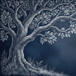
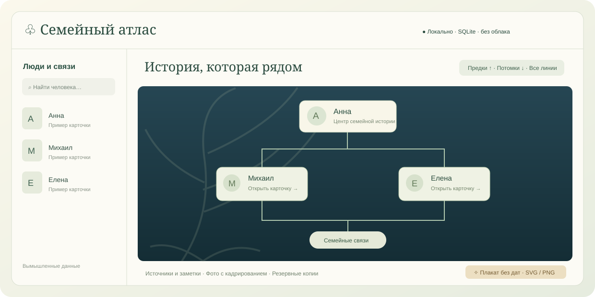

<div align="center">
  
  <h1>Семейный атлас</h1>
  <p><strong>История семьи — на вашем компьютере.</strong><br>Локальное приложение для родословной, семейных фотографий и красивых плакатов.</p>
  <p>
    
    
    
    <a href="LICENSE"></a>
  </p>
  <p><a href="#-установка">Установка</a> · <a href="#-сборка-из-исходников">Сборка</a> · <a href="#-ваши-данные">Данные</a> · <a href="#-вклад-в-проект">Участие</a></p>
</div>



> Иллюстрация выше — демонстрационная, не снимок настоящего семейного древа.

**Без аккаунтов, облака и запуска серверов.** Интерфейс и данные работают локально:
Tauri использует системный WebView, Rust выполняет операции с SQLite, а фотографии
хранятся отдельными файлами. Python и отдельный браузер приложению не нужны.

## ✨ Возможности

| История семьи | Фотографии и оформление | Надёжное хранение |
| --- | --- | --- |
| Люди, несколько браков и семей | Локальные JPG, PNG, GIF и WebP | SQLite и транзакции |
| Предки, потомки и оба направления | Неразрушающее кадрирование | Резервная копия перед изменениями |
| Независимое сворачивание ветвей | Отдельные рамки древа и плаката | Защита от конфликтов ревизий |
| Русский календарь и неполные даты | Художественный SVG/PNG **без дат** | Полная переносимая копия с фото |
| Источники, заметки, военные сведения | Фон дерева и оформление карточек | JSON и обмен через GEDCOM |

### Портреты, которые помещаются в рамку

В карточке человека выберите **«✂ Кадрировать портрет»** или **«Кадрировать»** под
фотографией. Перемещайте рамку, меняйте приближение и сразу проверяйте три вида:
прямоугольник древа, овал плаката и узкий овал супругов. Их можно настроить независимо
или объединить общим центром. Можно выбрать основное фото из нескольких.

**Оригинал не изменяется:** в базе сохраняются только настройки кадрирования.
Даже одно общее фото может иметь разные рамки у разных родственников.

### Семейный плакат

Кнопка **«✧ Семейный плакат»** открывает текущую раскрытую ветвь целиком, а не только
видимую область экрана. Учитываются направление, свёрнутые ветви, супруги и выбранные
портреты. **Даты, заметки, места и сведения о службе не выводятся.**

- **SVG** — векторные рамки и связи, фотографии и исходный PNG-фон встроены в файл.
- **PNG** — готовое изображение до 4096 пикселей по длинной стороне / 16 МП.
- Нет фотографии — нейтральный силуэт, не выдуманный портрет.

## 📦 Установка

Готовые пакеты распространяются через **GitHub Releases**, когда опубликован релиз.
Если релизов пока нет, используйте [сборку из исходников](#-сборка-из-исходников).
Сборки GitHub Actions также доступны во вкладке **Actions → нужный запуск → Artifacts**.

| Система | Пакет | Что необходимо |
| --- | --- | --- |
| Windows 10/11 x64 | `…_x64-setup.exe` | WebView2 Runtime; обычно уже установлен |
| macOS | `.dmg` / `.app` | Сборка для архитектуры вашего Mac, системный WKWebView |
| Linux | `.deb` / `.AppImage` | WebKitGTK 4.1 и зависимости дистрибутива |

### Windows

1. Скачайте установщик `Семейный атлас_<версия>_x64-setup.exe` из доверенного релиза.
2. Запустите установку и затем откройте **«Семейный атлас»** из меню «Пуск» или ярлыка.
3. Создайте первое дерево либо импортируйте JSON/GEDCOM через меню **«Файлы»**.

Rust, Node.js и Python **конечному пользователю не нужны**. Если WebView2 отсутствует,
установщику может потребоваться интернет для установки этого компонента Microsoft.
Для дальнейшей работы с деревом интернет не требуется.

> Сборки пока не подписаны сертификатом издателя. Windows SmartScreen и macOS
> Gatekeeper могут предупредить о неизвестном разработчике. Проверяйте источник
> загрузки; не отключайте защиту системы глобально ради установки.

### macOS и Linux

На macOS откройте `.dmg` и перенесите приложение в **Applications**. Убедитесь, что
архитектура пакета соответствует вашему Mac. На Linux установите подходящий `.deb`
через менеджер пакетов либо разрешите исполнение AppImage и запустите его:

```bash
chmod +x "./имя-скачанного-файла.AppImage"
"./имя-скачанного-файла.AppImage"
```

Названия файлов могут отличаться между форматами пакетов. AppImage не отменяет
системные зависимости, а для некоторых дистрибутивов требуется FUSE.

**Проверено локально:** Windows x64, включая настоящий WebView. macOS/Linux включены
в матрицу CI; успешность конкретной сборки проверяйте по её запуску Actions.

## 🛠 Сборка из исходников

### 1. Подготовьте инструменты

- [Git](https://git-scm.com/).
- [Rust stable](https://rustup.rs/) с Cargo. Локальная проверка: Rust 1.93.1.
- [Node.js LTS](https://nodejs.org/) и npm; в CI используется Node.js 22.
- [Системные зависимости Tauri 2](https://v2.tauri.app/start/prerequisites/).

<details>
<summary><strong>Windows: C++ Build Tools и WebView2</strong></summary>

Установите **Microsoft C++ Build Tools** с компонентом **Desktop development with C++**
и Windows SDK. Используйте MSVC-версию Rust (`stable-x86_64-pc-windows-msvc`).
Проверьте наличие Microsoft Edge WebView2 Runtime.

Сборка NSIS-установщика не требует отдельной ручной установки NSIS: Tauri CLI загружает
сборочные инструменты. Для MSI дополнительно могут понадобиться компоненты Windows,
указанные в документации Tauri; для простого начала используйте NSIS.

</details>

<details>
<summary><strong>macOS: инструменты Apple</strong></summary>

Установите Xcode / Command Line Tools и Rust:

```bash
xcode-select --install
```

Собирайте macOS-приложение на macOS. Для Universal-сборки установите оба Rust-target
(`aarch64-apple-darwin` и `x86_64-apple-darwin`) и используйте
`npm run build -- --target universal-apple-darwin`.

</details>

<details>
<summary><strong>Ubuntu 22.04/24.04: системные библиотеки</strong></summary>

```bash
sudo apt-get update
sudo apt-get install -y \
  libwebkit2gtk-4.1-dev build-essential curl wget file \
  libxdo-dev libssl-dev libayatana-appindicator3-dev librsvg2-dev patchelf
```

Для других дистрибутивов смотрите официальную инструкцию Tauri. Linux-приложение
собирается на Linux, Windows-приложение — на Windows; установка Rust-target сама по
себе не заменяет SDK и системные библиотеки другой ОС.

</details>

### 2. Получите исходники

На странице этого репозитория выберите **Code → HTTPS**, скопируйте адрес и выполните:

```bash
git clone <скопированный-HTTPS-адрес>
cd family-atlas-desktop
npm ci
```

Первое получение зависимостей требует интернета. `npm ci` и `Cargo.lock` фиксируют
версии зависимостей; семейные данные в исходниках отсутствуют.

### 3. Запустите режим разработки

```bash
npm run dev
```

Это `cargo run` со **встроенными локальными файлами** — без Vite и dev-сервера.
После изменения интерфейса перезапустите/пересоберите приложение. Node.js нужен для
скриптов разработки и Tauri CLI, а не для работы готового приложения.

### 4. Соберите приложение

```bash
npm run build
```

Только Windows NSIS-установщик:

```powershell
npm run build -- --bundles nsis
```

Только исполняемый файл, без упаковки:

```bash
npm run build -- --no-bundle
```

Результаты:

```text
src-tauri/target/release/
├── family-atlas-desktop.exe   # Windows; на Linux без расширения
└── bundle/
    ├── nsis/                 # Windows setup.exe
    ├── msi/                  # Windows, если выбран MSI
    ├── dmg/                  # macOS
    ├── deb/                  # Linux
    └── appimage/             # Linux
```

Не все перечисленные каталоги создаются на каждой ОС. Для сборки с `--target`
путь содержит дополнительный каталог target. На Windows после сборки можно запускать
`start.bat`; на Linux — `sh start.sh`. macOS-пакет удобнее открывать как `.app`.

## 🔒 Ваши данные

**Первый запуск создаёт пустое дерево.** Программа не поставляется с настоящими
именами, родословными или фотографиями чьей-либо семьи.

| Система | Каталог данных по умолчанию |
| --- | --- |
| Windows | `%APPDATA%\local.family-atlas.desktop\` |
| macOS | `~/Library/Application Support/local.family-atlas.desktop/` |
| Linux | `$XDG_DATA_HOME/local.family-atlas.desktop/`, обычно `~/.local/share/local.family-atlas.desktop/` |

Точный путь: **Файлы → Расположение данных**.

```text
family.sqlite   # люди, связи, события, источники, настройки кадрирования
photos/         # оригиналы изображений и manifest.json
backups/        # согласованные резервные копии SQLite
```

### Импорт, экспорт и резервные копии

- **Импорт JSON / GEDCOM** — проверяет файл и заменяет рабочее дерево после подтверждения.
- **Перенести проект с фотографиями** — принимает папку с `family.sqlite` и `photos/`
  либо прежний проект с `data/family.sqlite` и `photos/`. Исходник не изменяется.
- **Сохранить JSON** — переносит нативные сущности, цитирования, спорные сведения,
  кадрирование, дополнительные поля и журнал операций. Фото нужно переносить отдельно.
- **Полная копия с фотографиями** — создаёт новую папку с базой, JSON и фотографиями;
  это рекомендуемый способ переноса на другой компьютер.
- **Сохранить GEDCOM** — формат обмена с другими программами. Он не переносит все
  нативные поля, включая настройки кадрирования, и **не заменяет полную резервную копию**.

Перед изменениями создаётся резервная копия; сохранение выполняется транзакцией.
Ревизия повторно проверяется под блокировкой SQLite. Для ручного восстановления
сначала **полностью закройте приложение**, сохраните текущую копию каталога и только
затем подменяйте базу. Не заменяйте файл работающей базы.

Ссылки источников открываются во внешнем браузере **только по явному нажатию**.
Автоматической загрузки внешних фото, аналитики и облачной синхронизации нет.
Перед передачей плаката или архива проверьте, нет ли в нём данных живых родственников.

## ✅ Проверки

```bash
npm test
cargo test --locked --manifest-path src-tauri/Cargo.toml
npm run check:publication
```

Локально пройдены **18 Rust-тестов, 53 JavaScript-теста и 24 проверки настоящего
Windows WebView**, включая независимые рамки, пиксели экспортируемых портретов,
отмену кадрирования, сохранность оригинала, конфликты ревизий и PNG-растеризацию.

Все тестовые данные синтетические; тесты хранилища используют временные каталоги.
Python не нужен даже для тестов. Как запустить изолированную проверку WebView:
[docs/TESTING.md](docs/TESTING.md).

## 🧩 Устройство проекта

```text
src-tauri/src/
├── domain.rs          # проверки и неразрушающее редактирование
├── store.rs           # SQLite, ревизии, резервирование, перенос
├── schema.sql         # таблицы нативных сущностей
├── gedcom.rs          # самостоятельный адаптер обмена
└── commands.rs        # ограниченные команды Tauri IPC
web/
├── app.mjs            # интерфейс и карточки
├── layout.mjs         # независимая геометрия древа
├── date-picker.mjs    # русский календарь
├── photo-editor.mjs   # редактор рамок
├── photo-crop.mjs     # общая геометрия кадрирования
├── photo-render.mjs   # производные портреты только в памяти
└── poster*.mjs        # художественный SVG/PNG без биографического payload
```

### Что важно знать

- WebView — системный компонент, не отдельный браузер. Нужна отдельная сборка под каждую ОС.
- Неполные/спорные даты сохраняют исходную точность; приложение не угадывает век.
- Проверка файла фото по сигнатуре и размеру не заменяет антивирусную проверку.
- Источники, заметки и оформление — не автоматическое подтверждение родства или биографии.
- Не все дополнительные поля имеют собственный редактор в интерфейсе, но JSON их сохраняет.

## 🤝 Вклад в проект

Идеи и ошибки — через **Issues**, изменения — через **Pull requests**.
Пожалуйста, прикладывайте только вымышленные примеры: не отправляйте реальную базу,
семейные фотографии, экспорт GEDCOM или неотредактированный скриншот.

- [Как участвовать](CONTRIBUTING.md)
- [Сообщить об уязвимости](SECURITY.md)
- [Что не должно попасть в публичный Git](docs/PUBLISHING.md)

## 📄 Лицензия

Исходный код распространяется по **[MIT](LICENSE)**.
Фон дерева и производные значки имеют отдельный статус: **[NOTICE.md](NOTICE.md)**.
Публичный доступ к репозиторию не означает автоматическую MIT-лицензию на эти изображения.
Установщики включают `LICENSE.txt` и `NOTICE.md`; пользовательские базы и фото в них не встраиваются.
